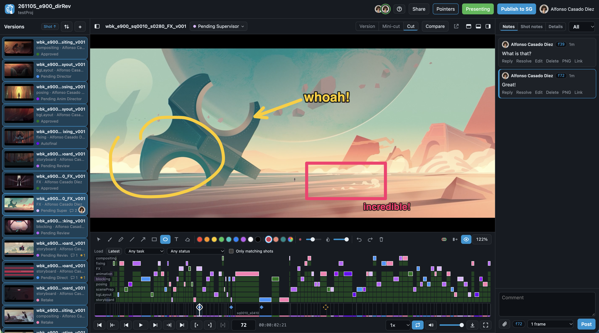

<p align="center">
  
</p>

<p align="center">
  <strong>Frame-accurate review of ShotGrid Versions with annotations, a live presentation and Note loopback to SG.</strong>
</p>

<p align="center">
  <a href="https://github.com/alfonsocasadodiez/fpt_reviewMeh/releases/latest"></a>
  <a href="https://hub.docker.com/r/alfonsocasadodiez/reviewmeh"></a>
  <a href="https://github.com/alfonsocasadodiez/fpt_reviewMeh/actions/workflows/docker-publish.yml"></a>
  <a href="LICENSE"></a>
  <a href="https://www.python.org"></a>
  <a href="https://www.autodesk.com/products/flow-production-tracking"></a>
  
</p>

<p align="center">
  <a href="#-what-it-does">What it does</a> ·
  <a href="#️-keyboard-shortcuts">Shortcuts</a> ·
  <a href="#-quick-start">Quick start</a> ·
  <a href="#-configuration">Configuration</a> ·
  <a href="#-exports">Exports</a> ·
  <a href="#-security">Security</a>
</p>

---

## 🎬 Overview

ReviewMeh is a self-hosted review tool for [ShotGrid / Flow Production Tracking](https://www.autodesk.com/products/flow-production-tracking). It is built around the workflow we follow at [Peekaboo Animation](https://peekabooanimation.com/) and around what I expect from a current review tool but couldn't find at a fair price: a frame-accurate player with vector drawings, timecoded and threaded notes and a live review room, all connected to ShotGrid and able to publish the data back to it.

> [!NOTE]
> ReviewMeh is in production use at one studio, on one ShotGrid site, so expect some rough edges, bugs and incompatibilities. Please open an issue when you hit one.

> **Documentation**
> - **[ShotGrid setup](docs/shotgrid-setup.md):** the Script, permission groups, cuts, live updates and reverse proxies.
> - **[Security](docs/security.md):** read this before putting ReviewMeh on the internet.
> - **[Example configuration](src/reviewmeh/reviewmeh.example.toml):** all environment variables.



<p align="center"><em>The ReviewMeh interface.</em></p>

---

## ✨ What it does

- **Player.** Frame-accurate playback with frame-by-frame stepping. Review one version, several back to back, a mini-cut that includes the shots on either side, or a whole cut. Mini-cuts and whole cuts rely on [your site's cut information](docs/shotgrid-setup.md#cuts), and you can load them by task, by status, both, or the latest of everything. The player also has In/Out points, zoom and onion skin, and shows the playhead position in either frames or timecode.
- **Drawing.** Pen pressure-sensitive brush, marker, shapes, text and eraser, color picker and preset colors, and controls for size and opacity. You can move, edit and resize a drawing after making it, and copy and paste annotations between frames.
- **Notes.** Every note is timecoded. Notes can also cover a frame range and carry file attachments, and everything is saved as you work.
- **Compare.** View any other version within the same link side by side, as a wipe, blended or as a difference.
- **Live room.** Present to everyone in the review, with your pointer on their screens. Everyone can show or hide the pointers of the others on the same version.
- **Transcoding.** Admins set the quality and maximum width of the movies ReviewMeh plays, on the main page, and can clear the processed movies of one review or all of them. Cleared movies are made again when next opened. The same tab shows live CPU, memory and disk use, and each movie being transcoded.
- **Publish to ShotGrid.** Notes go back to ShotGrid in a thread, ordered by frame number. The thread includes the annotated frames and a link back to ReviewMeh, where the annotations play inside the video.
- **Exports.** Export a PDF report with notes and annotations, the annotated frames organized in a ZIP, or the text as a CSV.
- **Sharing.** Share links to users or guests into a review, with control over their rights and an optional password.
- **Access.** People sign in through ShotGrid's App Session Launcher, so everything works in the context of the signed-in user and matches their permission group.
- **From ShotGrid.** ReviewMeh handles Action Menu Items and webhooks itself. It creates the menu items using the public URL from your `.env`, and it prints the details to enter for the optional webhook.

---

## ⌨️ Keyboard shortcuts

Press `?` in a review to see these at any time. On a Mac, `Cmd` works in place of `Ctrl`.

| Category | Action | Shortcut |
| :--- | :--- | :--- |
| **Playback** | Play / pause | `Space` / `K` |
| **Playback** | Previous / next frame (10 frames with `Shift`) | `←` / `→` |
| **Playback** | First / last frame | `Home` / `End` |
| **Playback** | Previous / next version | `[` / `]` |
| **Playback** | Select versions to play back to back | `Cmd/Ctrl` or `Shift` + click |
| **Marking** | Set In / Out | `I` / `O`, or `Shift`-drag the timeline |
| **Marking** | Clear In / Out and selection | `Esc` |
| **Drawing** | Select, brush, marker, line, arrow | `V` `B` `P` `N` `A` |
| **Drawing** | Rectangle, ellipse, text, eraser | `R` `C` `T` `E` |
| **Drawing** | Color | `1`–`9` |
| **Drawing** | Square / circle, keep proportions | `Shift` + drag |
| **Drawing** | Edit text | Double-click the text |
| **Drawing** | Delete selected shape | `Delete` |
| **Drawing** | Undo / redo | `Ctrl+Z` / `Ctrl+Shift+Z` |
| **Drawing** | Cut, copy, paste a drawing to another frame | `Ctrl+X` / `C` / `V`, or right-click |
| **Drawing** | Onion skin | `U` |
| **Drawing** | Hold until next drawing | `G` |
| **Drawing** | Show drawings | `H` |
| **View** | Zoom | Wheel, or `+` / `−` |
| **View** | Fit to screen (fit to width or height and sizes from the zoom button) | `0` |
| **View** | Pan | Middle-drag |
| **View** | Zoom timeline (`Shift` pans) | Wheel on the timeline |
| **View** | Hide / show panels | `\` |
| **View** | Mute / fullscreen | `M` / `F` |
| **Notes** | Previous / next note | `↑` / `↓` |
| **Notes** | Comment | `Enter` |
| **Notes** | Post | `Ctrl+Enter` |

---

## 📋 Requirements

- Docker and git in a machine with fairly decent specs (it's going to transcode every shot it loads!)
- A ShotGrid site where you can add a Script with its own permission group and turn on the App Session Launcher
- HTTPS and a reverse proxy, if you need to share reviews through public links

---

## 🚀 Quick start

1. **In ShotGrid,** [add a Script with its own permission group and turn on the App Session Launcher](docs/shotgrid-setup.md#1-add-a-script). We recommend not using an API Admin Script.
2. **Clone this repository and fill in the four environment variables:**
   ```bash
   git clone https://github.com/alfonsocasadodiez/fpt_reviewMeh.git
   cd fpt_reviewMeh
   cp .env.example .env
   $EDITOR .env        # Fill in your site's URL, script name, key and the URL the tool will be accessed from.
   ```
3. **Start ReviewMeh and check your site.** This pulls [the image from Docker Hub](https://hub.docker.com/r/alfonsocasadodiez/reviewmeh):
   ```bash
   docker compose up -d
   docker compose exec reviewmeh reviewmeh check
   ```
4. **Add the menu buttons to ShotGrid:**
   ```bash
   docker compose exec reviewmeh reviewmeh setup-amis --apply
   ```

To try it, select a Playlist or some Versions in ShotGrid and choose **Send to Review** from the menu. ReviewMeh opens in a few seconds.

Next, [give your permission groups their rights](docs/shotgrid-setup.md#permission-groups). `reviewmeh check` lists your groups.

To update later, run `git pull && docker compose pull && docker compose up -d`.

### The secrets

ReviewMeh creates three random secrets on first start and keeps them in `/data/secrets`. You don't need to manage them yourself.

| Secret | What it does | Where it goes |
|---|---|---|
| Sign-in secret | Signs sign-in cookies | Stays in ReviewMeh |
| Menu key (`ami_key`) | Keeps strangers off the menu button addresses | `reviewmeh setup-amis --apply` writes it into ShotGrid |
| Webhook token | Proves that live updates come from ShotGrid | `reviewmeh webhook` prints it, if you want live updates |

The secrets stay the same across restarts and new images as long as you keep the `reviewmeh-data` volume. If you lose the volume, run `setup-amis --apply` again and re-enter the webhook token. Everyone will also have to sign in again.

### Without Docker

You need Python 3.11+, `ffmpeg` and `ffprobe`. PDF reports also need Pango (`libpango-1.0-0` on Debian and Ubuntu).

```bash
python3 -m venv .venv && . .venv/bin/activate
pip install ".[pdf]"
reviewmeh init             # writes reviewmeh.toml
$EDITOR reviewmeh.toml     # the same four values
reviewmeh check
reviewmeh setup-amis --apply
reviewmeh serve
```

---

## 🔧 Configuration

Most sites only need the four values in `.env`. Any other setting can go there too, named `REVIEWMEH_<SECTION>_<KEY>`, so `storage.media_root` becomes `REVIEWMEH_STORAGE_MEDIA_ROOT`. Separate list values with commas. You can also use a `reviewmeh.toml` file, but environment variables take priority over it.

[The example file](src/reviewmeh/reviewmeh.example.toml) lists every option available. These are the ones most sites change:

| Option | What it sets |
|---|---|
| `branding.app_name`, `logo`, `accent` | Your name, logo and color |
| `storage.media_root` | Where proxies, attachments and exports go. A network mount is fine, but the database must stay on a local disk |
| `storage.cache_days` | [How long unused proxies are kept](#cache-cleanup), 15 days by default. `0` keeps them |
| `access.admin_group` | The ShotGrid permission groups that run ReviewMeh, if not `Admin`. Environment variable: `REVIEWMEH_ADMIN_GROUP` |
| `schema.cut_by` | [What groups shots into a cut](docs/shotgrid-setup.md#cuts). Found per project by default. Environment variable: `REVIEWMEH_CUT_BY` |
| `schema.omit_status` | Shot statuses left out of cuts, if not `omt` |
| `schema.cut_order`, `task_order` | Your field names for cut order and pipeline order, if they differ |
| `schema.note_type`, `note_types` | A Note field for note types, offered when publishing |
| `schema.status_colors` | Overrides for the colors ShotGrid has for statuses |

### Cache cleanup

Once a day, ReviewMeh deletes proxies, thumbnails and local copies of ShotGrid's note images that haven't been used for 15 days. Versions in a review that someone has open are kept. When a review is opened again, its proxies are rebuilt from ShotGrid.

Notes, drawings, drafts and the files people attach to notes are stored separately and aren't deleted, so drawings can be viewed and edited again once the proxy is rebuilt. Rebuilding needs the movie to still be in ShotGrid. If it has been removed, the notes remain but their frames can't be shown.

---

## 🔗 From ShotGrid

ReviewMeh answers these requests from ShotGrid:

| Address | What it is |
|---|---|
| `POST /ami/review?key=…` | **Send to Review**: opens the Playlist's review, or a new review for the selected Versions, and adds anything new |
| `POST /ami/publish?key=…` | **Publish Review Notes**: opens the review with the publish dialog |
| `POST /ami/export?key=…` | **Export Review Notes**: opens the review with the export dialog |
| `POST /hooks/shotgrid` | Optional [webhook](docs/shotgrid-setup.md#live-updates): sends status changes to open reviews, processes replaced movies again and refreshes cuts |

---

## 📤 Exports

In a review, open **Download → Export** or right-click the versions, then export the current version, a selection or all of them. Exports require the Download right and cover posted notes.

| Export | Contains |
|---|---|
| PDF report | A summary table, then each note's annotated frame beside its text, replies and attachments. Needs `reviewmeh[pdf]` |
| Frames ZIP | One captioned PNG per drawn note, in a folder per version |
| Notes CSV | One row per note and reply, safe to open in Excel |

---

## 🔒 Security

Read [docs/security.md](docs/security.md) before putting ReviewMeh on the internet. In short, nothing from ShotGrid's menu is taken as proof of identity, the app holds a Script key that can read across your site, and guest uploads are off by default.

---

## 📄 License

ReviewMeh is open-source software licensed under the [MIT License](LICENSE)

Disclaimer: ReviewMeh is an independent tool not affiliated with Flow Production Tracking nor Autodesk..
